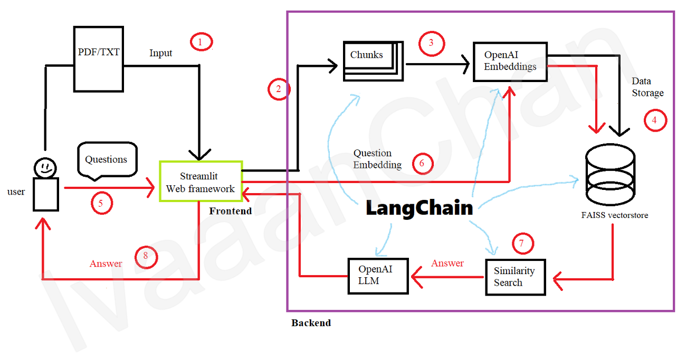

# AI Student Assistant (Final Year Project in Nov 2023)

A conversational PDF study assistant built with Python and Streamlit. Upload one or more PDF documents, process their text, and ask questions about the uploaded material through a chat interface.

The application uses Retrieval-Augmented Generation (RAG):

1. PDF pages are read with PyPDF2.
2. Document text is split into chunks of 500 characters with 24-character overlap.
3. OpenAI embeddings are stored in an in-memory FAISS vector database.
4. A conversational retrieval chain uses `gpt-3.5-turbo` and conversation memory to answer questions.

> **Note:** This project is a 2023 implementation and may require dependency updates or API configuration changes afterwards.

## Features

📄 **Multi-PDF Support** – Upload and process multiple PDF documents <br>
🔍 **Semantic Search** – Retrieve relevant passages using embeddings and FAISS similarity search <br>
🤖 **RAG-powered Q&A** – Generate context-aware answers based on retrieved document content <br>
🧠 **LLM Integration** – Use OpenAI's `gpt-3.5-turbo` to understand user queries and generate natural-language responses <br>
💬 **Chat History** – Preserve conversation history within the Streamlit session <br>
⏳ **Processing Feedback** – Display progress and status updates during document processing

## Demo Video

https://github.com/user-attachments/assets/23bb4830-5f0c-4fc4-80d1-52b780a4b47f

Example prompts:

- “Summarize the key ideas in these documents.”
- “Explain this topic in simple language.”
- “What are the main arguments in Chapter 2?”
- “Create a few revision questions based on the uploaded PDFs.”

## Technology Stack

| Technology | Use |
|---|---|
| Python | Application logic |
| PyPDF2 | PDF text extraction |
| LangChain | Text splitting and conversational retrieval chain |
| OpenAI API | Embeddings and chat completions |
| FAISS | In-memory vector similarity search |
| Streamlit | Web interface and chat UI |

The application is configured to use:

- Chat model: `gpt-3.5-turbo`
- Chunk size: 500 characters
- Chunk overlap: 24 characters
- Vector store: in-memory FAISS

## Project Structure

```text
AI-Student-Assistant/
├── Test_doc/               # Example PDF documents
├── .gitignore
├── RAG_visual.png          # Workflow visualization
├── README.md
├── demo.mp4                # Application demo video
├── main.py                 # Main application entry point
└── requirements.txt        # Required packages with version
```

## Getting Started

### Prerequisites

- Python 3.9 or later
- `pip`
- An OpenAI API account and API key

### 1. Clone the repository

```bash
git clone https://github.com/IvaaanChan/AI-Student-Assistant
cd AI-Student-Assistant
```


### 2. Create a virtual environment

**macOS / Linux**

```bash
python3 -m venv .venv
source .venv/bin/activate
```

**Windows PowerShell**

```powershell
python -m venv .venv
.venv\Scripts\Activate.ps1
```

### 3. Install dependencies

```bash
python -m pip install --upgrade pip
python -m pip install -r requirements.txt
```

The direct dependencies are pinned in [`requirements.txt`](requirements.txt) for repeatable setup. Installing in a virtual environment is strongly recommended.

### 4. Configure your OpenAI API key

Open [`main.py`](main.py) and replace the placeholder in:

```python
os.environ["OPENAI_API_KEY"] = "YOUR_API_KEY"
```

### 5. Run the application

```bash
streamlit run main.py
```

Open the local URL shown in your terminal. For example:

```text
http://localhost:8501
```

## How It Works



### Document Ingestion (Data source)

```text
Load documents
     |
     v
Extract texts
     |
     v
Split the texts into chunks
     |
     v
Generate embeddings with text embedding model
     |
     v
Store vectors in a vector DB
```

### Query

```text
Receive user query
     |
     v
Generate query embedding
     |
     v
Perform similarity search
     |
     v
Retrieve relevant chunks
     |
     v
Send query & retrieved chunks to LLM
     |
     v
LLM generate and return answer to the front-end using natural language
```

This workflow combines semantic retrieval with LLM-based generation. By retrieving relevant document chunks through vector similarity search and providing them as context to the LLM, the application generates responses grounded in the uploaded documents.

## Privacy and Security

- Uploaded document content may be processed by OpenAI services during the RAG workflow.
- Sensitive or restricted documents should only be uploaded when appropriate authorization is in place.
- API keys and credentials should be managed through environment variables and excluded from source control.
- Additional authentication and access controls would be required for a multi-user deployment.

## Limitations

- Scanned PDFs without an extractable text layer require OCR before processing.
- Complex document structures such as tables, images, equations, and multi-column layouts may not be extracted accurately.
- The vector index is currently stored in memory and is rebuilt when the application restarts.
- Generated answers may occasionally be incomplete or inaccurate, even when relevant context is retrieved.
- Conversation state and processed documents are scoped to the current Streamlit session.

## Future Improvements

Potential enhancements to the application include:

- Improve input validation and provide clearer document-processing error messages.
- Store the vector index locally so it can be reused after application restarts.
- Add source-page references and citations to make generated answers easier to verify.
- Update LangChain dependencies and APIs for compatibility with current releases.

## License

Copyright © 2026 IvaaanChan. All rights reserved.

This repository is publicly available for portfolio and demonstration purposes only. No permission is granted to copy, modify, distribute, or use the source code for commercial or non-commercial purposes.
